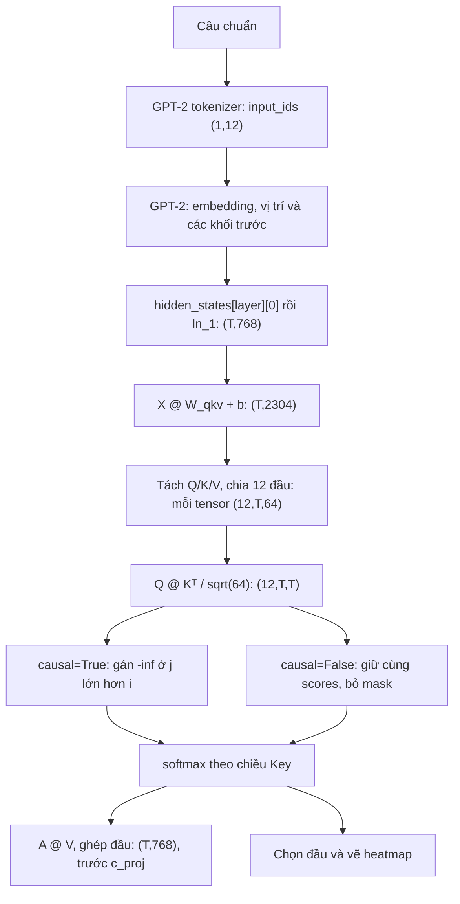

# 02 - Thiết kế demo theo lý thuyết Transformer

**Mã hồ sơ: DESIGN. Cập nhật: 14/11/2026.**

## Kiến trúc đã chọn

Toàn bộ code thực thi nằm trong [self_attention_demo.ipynb](../../self_attention_demo.ipynb), để người xem thấy từng phép toán. PyTorch tính tensor, Transformers tải GPT-2/tokenizer và đối chứng, Matplotlib xuất hình. Không tách thành web/app hay nhiều module chỉ để giống một kiến trúc mẫu.

Theo PDF trang 14–17, demo dùng **decoder-only GPT-2**. Sơ đồ encoder–decoder ở trang 5/12/15 là nền lý thuyết; không bổ sung encoder hoặc cross-attention vào notebook này.

## Luồng dữ liệu và kích thước

`T=12` cho câu mẫu. Mỗi hàng attention ứng với token Query; mỗi cột là Key. Mask không chặn đường chéo. Với mọi hàng còn ít nhất vị trí chính nó nên không tạo hàng toàn `-inf` trong câu hợp lệ.

`W_qkv` có shape `(768,2304)`, bias `(2304,)`, lấy từ `model.h[layer].attn.c_attn`. Lấy đầu vào sau `ln_1` để đúng GPT-2 pre-LayerNorm, không áp nguyên sơ đồ Add & Norm trong PDF vào code.

## Hợp đồng hàm thực tế

| Hàm | Đầu vào | Trả về / lỗi |
| --- | --- | --- |
| `get_layer_input(model, input_ids, layer)` | Model, ID token, lớp | `(T,768)` sau `ln_1` |
| `get_qkv_weights(model, layer)` | Model và lớp | Weight/bias QKV của lớp |
| `self_attention(x,w_qkv,b_qkv,n_head=12,causal=True)` | Tensor 2D, weight, bias | `(out,attn)`; `out` chưa qua `c_proj` |
| `find_token(token_list,word)` | Nhãn token và từ | Chỉ số; thiếu từ báo `ValueError` tiếng Việt |
| `pick_head(src:int,tgt:int)` | Chỉ số Query/Key | `(layer,head,value)`; in top 3 trong hàm |
| `plot_attention(attn_no_mask,attn_mask,tokens,title,path_prefix)` | Hai ma trận đầu được chọn và nhãn | Xuất hình so sánh + hai PNG riêng, cùng thang 0–1 |
| `benchmark(lengths,device,n_rep=20)` | Độ dài, thiết bị, số lặp | Danh sách `{len,ms,mem_mb}`; lỗi OOM được bắt trong vùng `try` ghi `None` |

Demo mới dùng đúng tên/chữ ký hàm của kế hoạch. Phần chính trình bày Implementation, đối chiếu, heatmap và bảng so sánh; code benchmark/kiểm tra được đặt ở phụ lục thu gọn.

## Thiết kế đối chứng và trực quan hóa

Nạp GPT-2 với `attn_implementation="eager"`, đặt `eval()`, float32. So attention tự tính với `model(...,output_attentions=True).attentions[layer][0]` ở từng lớp. Ngưỡng luôn giữ `1e-4`.

Quét 12 lớp ×12 đầu và chọn attention `it` → `animal` lớn nhất sau mask, in top 3. Tính lại cùng lớp/đầu với `causal=False` và `True`; hai panel dùng chung thang 0–1, một thanh màu, nhãn token đã bỏ `Ġ`. Lưu hình so sánh và hai hình riêng, dpi 200. Không mask là phép thử minh họa; không phải inference hai chiều nguyên bản của GPT-2.

## Thiết kế benchmark và giới hạn

Benchmark gọi hàm tự viết trên `x` và weight ngẫu nhiên seed 42, 12 đầu ×64 chiều, độ dài 128/256/512/1024/2048. Chạy inference mode, warm-up 3; CPU và GPU đều lặp 20, lấy trung vị. GPU đồng bộ trước/sau bấm giờ.

2048 ở đây là kích thước tensor nhân tạo cho phép attention, **không phải** chạy GPT-2 với context 2048; config checkpoint có `n_positions=1024`.

GPU báo `max_memory_allocated()/2**20` sau reset peak, bao gồm tensor còn sống từ GPT-2. CPU tính `attn.nelement()*attn.element_size()` từ ma trận thực trả về, cùng shape/dtype với scores; không tạo dummy và không đo đỉnh RAM tiến trình. Hai đường không cùng phạm vi đo và đều ghi đơn vị MiB. Các cấp phát weight/bias/input, làm nóng và đo đều trong `try`; OOM ghi `None` rồi dọn tham chiếu/đo tiếp.

## Quyết định và trạng thái

| ID | Quyết định | Lý do / trạng thái |
| --- | --- | --- |
| DEC-001 | Dùng trọng số GPT-2 đã huấn luyện | Lựa chọn nhóm, đáp ứng yêu cầu công khai nguồn trọng số |
| DEC-002 | Một notebook, hàm attention tự viết | Phù hợp trình diễn từng bước và yêu cầu môn học |
| DEC-003 | Giữ √d_k, mask cộng và đầu ra trước `c_proj` | Khớp phép tính theo đầu, PDF trang 17 và hợp đồng thực tế |
| DEC-004 | Chọn đầu theo `it` → `animal` lớn nhất | Công khai tiêu chí, không coi mẫu được chọn là đại diện toàn model |
| DEC-005 | OOM có ghi nhận, không nới ngưỡng đối chứng | Đã thử mô phỏng ở weight/bias/input và attention, gồm tình huống toàn bộ mốc OOM |
| DEC-006 | RTX 5060 Laptop/cu128 | Người dùng duyệt ngày 14/11/2026; nguồn hướng dẫn đã được đồng bộ |
| DEC-007 | Rút gọn demo theo yêu cầu mới | Implementation + giải thích ngắn, so sánh lý thuyết; benchmark ở phụ lục, tệp trình chiếu đã được bỏ ở lượt dọn repo; tài liệu kỹ thuật và output vẫn giữ |

Lý thuyết và các điểm cần phân biệt được kiểm soát ở [THEORY](../THEORY.md); kết quả thiết kế được kiểm tra ở [TEST_RESULTS](../08-test/TEST_RESULTS.md).
