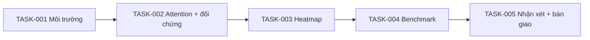

# 03 - Kế hoạch và tiến độ bài demo

**Mã hồ sơ: PLAN. Cập nhật: 14/11/2026.**

## Thứ tự và phụ thuộc

Giữ 5 task của [kế hoạch gốc](../../docs/superpowers/plans/2026-11-10-self-attention-demo.md): môi trường → attention/đối chứng → heatmap → benchmark → nhận xét/hướng dẫn/bản chạy cuối. Các task đã có code; không lập lại dự án hoặc hồi tố lịch sử TDD chưa có bằng chứng.

## Mốc công việc và trạng thái thực tế

| Task | Phạm vi | Cơ sở PDF | Bằng chứng | Trạng thái |
| --- | --- | --- | --- | --- |
| TASK-001 | Venv, requirements, model/tokenizer, thông tin máy | Trang 17 | Commit `55a1ad7`, log GPU | Đã triển khai; máy mới đã được duyệt |
| TASK-002 | QKV, chia đầu, scores/mask/softmax/V và đối chiếu 12 lớp | Trang 7/9/11/17 | Commit `43d7c10`, AC-002 | Đạt kiểm tra số học |
| TASK-003 | Quét đầu, 3 PNG, nhận xét heatmap | Trang 8/18 | Commit `89a2b15`, AC-003–004 | Đạt: plot_attention đúng API; nhận xét lấy từ head thật, giới hạn được ghi rõ |
| TASK-004 | Đo CPU/GPU, bảng và biểu đồ | Trang 19 | Commit `7961be7`, log GPU/CPU | Đạt: hai thiết bị 20 lần, đo ma trận thật trên CPU, OOM có kiểm tra |
| TASK-005 | Ưu/nhược điểm, README, offline và VS Code | Trang 3–16/19 | Commit `19f3203`, AC-007–008 | Demo ngắn/Implementation/so sánh đã có; CLI đạt, UI tự chạy chưa xác nhận |

Các commit chứng minh file đã được lưu, không chứng minh đã chạy assert thất bại trước khi viết code hoặc Run All trước từng commit. Trạng thái chi tiết ở [TEST_RESULTS](../08-test/TEST_RESULTS.md).

## Bản hoàn thiện workflow theo yêu cầu mới

1. Đọc đủ 20 trang PDF và đối chiếu công thức/kiến trúc với GPT-2 cục bộ.
2. Viết nội dung thật cho từng bước 01–14; giữ các mục chưa thực hiện ở trạng thái chưa thực hiện.
3. Chuyển hồ sơ cũ về đúng thư mục chịu trách nhiệm, cập nhật toàn bộ liên kết, loại GUIDE và bản trùng.
4. Giữ log gốc, lập dữ liệu số đối chiếu log; bổ sung manifest và kiểm tra tính toàn vẹn.
5. Kiểm tra nội dung, nguồn, số liệu, danh mục và diff; commit riêng workflow và push main theo quyền đã có của repo.

## Bổ sung và trạng thái sản phẩm

Người dùng đã giao sửa demo và bổ sung Implementation, so sánh lý thuyết Transformer/CNN/RNN, giải thích ngắn. REVIEW-001–006 được sửa trong code/nguồn hướng dẫn; có kiểm tra offline, CPU giả lập và luồng toàn bộ mốc OOM. Còn bước người trình bày tự Restart/Run All trong VS Code; người dùng đã yêu cầu không dùng Computer Use.

Không cắt ba phần trọng tâm để khớp mốc thuyết trình. Lượt sửa demo có thay đổi notebook và log mới, không lấy log của lượt chỉ sửa workflow làm bằng chứng cho code mới. Phạm vi nhiệm vụ cụ thể ở [TASK_BRIEFS](../04-describe/TASK_BRIEFS.md), điều kiện bàn giao ở [ACCEPTANCE](../14-definition-of-done/ACCEPTANCE.md).
