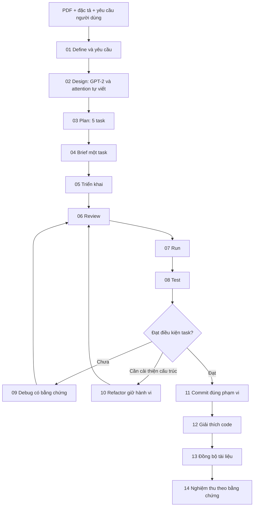

# Luồng thực hiện bài self-attention

**Mã hồ sơ: PROCESS. Cập nhật: 14/11/2026.**

## Quy trình áp dụng

Debug/refactor không phải việc phải làm để đủ số bước. Lần viết lại hiện tại áp dụng vòng Review/Test vào chính hồ sơ và bộ kiểm soát tài liệu; không làm lại code 5 task đã có. Tài liệu lý thuyết liên quan được truy vết ở THEORY, trạng thái thực nghiệm ở TEST_RESULTS và trạng thái kết thúc ở ACCEPTANCE.

## Vòng kiểm soát file

Yêu cầu/nguồn đổi → chọn file chịu trách nhiệm → sửa nội dung và bên tham chiếu → kiểm tra nguồn/số liệu → cập nhật manifest cho phần đã duyệt → chạy checker/tests → review diff → commit/push theo quyền đã có. Không tự nâng “chưa xác minh” thành “đạt”. Chi tiết ở [CONTROL](CONTROL.md).
