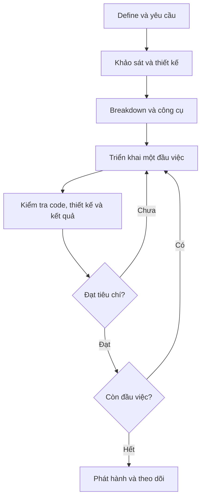

# Sơ đồ quy trình

Sơ đồ là đường dẫn để làm việc, không phải danh sách phải điền đủ bất kể quy mô.
Lưu đồ dưới đây thể hiện vòng lặp kiểm chứng.

## Dùng file nào ở thời điểm nào?
| Thời điểm | File cần dùng |
| --- | --- |
| Bắt đầu dự án | README.md; 01_DEFINE; 02_REQUIREMENTS |
| Chọn phương án | 03_DESIGN; 05_TOOLS |
| Chuẩn bị triển khai | AGENTS.md; 04_BREAKDOWN |
| Code, debug, kiểm tra | 04_BREAKDOWN; 06_VERIFICATION |
| Kết thúc buổi | 07_WORK_LOG |
| Phát hành | 08_RELEASE |

Nếu kiểm tra cho thấy yêu cầu hoặc thiết kế sai, quay lại cập nhật phần đó; không chỉ sửa code.
