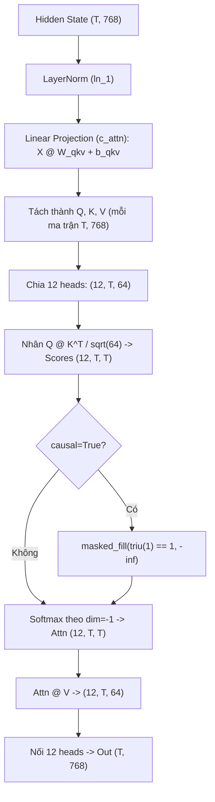

# Khảo sát và thiết kế

## Khảo sát dự án hiện có
- **Mô hình mục tiêu**: GPT-2 (`gpt2`, 124M tham số, 12 layers, 12 heads, $d_{model}=768$, $d_{head}=64$).
- **Điểm trích xuất trọng số**:
  - Trọng số chiếu $Q, K, V$: `model.h[layer].attn.c_attn.weight` shape $(768, 2304)$, `bias` shape $(2304,)$.
  - Trọng số và cơ chế chuẩn hóa LayerNorm: `model.h[layer].ln_1`.
- **Cấu hình mô hình chuẩn làm đối chứng**:
  - `GPT2Model.from_pretrained("gpt2", attn_implementation="eager")`.
  - Chạy `model(input_ids, output_attentions=True, output_hidden_states=True)`.
  - Không thêm token BOS đặc biệt để danh sách token khớp nguyên bản câu ví dụ.

## Thiết kế chi tiết hàm Self-Attention tự viết

### Công thức toán học
$$\text{Attention}(Q, K, V) = \text{softmax}\left(\frac{Q K^T}{\sqrt{d_k}} + M\right) V$$

Trong đó:
- $M_{i,j} = 0$ nếu $j \le i$
- $M_{i,j} = -\infty$ nếu $j > i$ (khi `causal=True`)

### Sơ đồ luồng tính toán

## Quyết định thiết kế (Design Decisions)

| Mã | Quyết định | Vì sao | Đánh đổi / Lựa chọn thay thế | Trạng thái |
| --- | --- | --- | --- | --- |
| **DEC-001** | Nạp trọng số đã huấn luyện của GPT-2 | Giảng viên doanh nghiệp yêu cầu chứng minh mô hình thực tế; heatmap có ý nghĩa ngôn ngữ thay vì nhiễu ngẫu nhiên. | Tốn ~500MB tải mô hình từ HF (khắc phục bằng offline cache). | Đã chốt |
| **DEC-002** | Toàn bộ code nằm trong 1 file notebook `self_attention_demo.ipynb` | Người thuyết trình dễ dàng trình diễn từng bước trong VS Code; người chấm xem được liền mạch. | Khó viết pytest truyền thống (khắc phục bằng các ô `assert` và `nbconvert`). | Đã chốt |
| **DEC-003** | Tự code từng phép toán, cấm dùng `scaled_dot_product_attention` | Mục tiêu cốt lõi của môn học là hiểu sâu cơ chế toán học bên dưới. | Tốc độ chậm hơn kernel FlashAttention được compile sẵn (nhưng mục đích là demo giáo dục). | Đã chốt |
| **DEC-004** | Tự động quét chọn layer/head có liên kết "it" $\rightarrow$ "animal" mạnh nhất | Tránh việc chọn lén lút thiếu khách quan; đảm bảo tính minh bạch học thuật. | Thêm ô code quét 144 heads (chạy rất nhanh, chỉ mất < 0.5s). | Đã chốt |
| **DEC-005** | Bắt lỗi OOM trong benchmark và tiếp tục chạy | Giữ notebook không bị crash giữa chừng khi đo chuỗi độ dài lớn. | Cần xử lý hiển thị giá trị `None` trên đồ thị và bảng biểu. | Đã chốt |

## Điểm cần kiểm tra trước khi hoàn thiện
- [x] Thiết kế đáp ứng toàn bộ yêu cầu trong phạm vi của giảng viên.
- [x] Luồng xử lý lỗi và tính toán tensor nhất quán.
- [x] Sai số tuyệt đối với mô hình gốc được khống chế dưới $10^{-4}$.
- [x] Các hình ảnh được xuất ra file PNG độ phân giải cao phục vụ thuyết trình.
